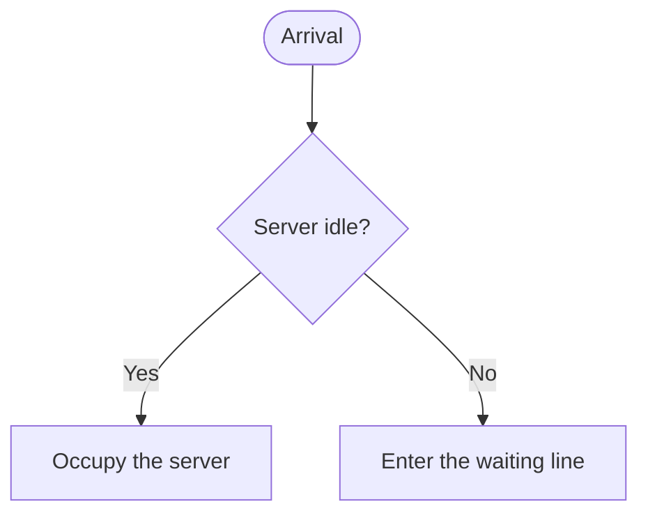
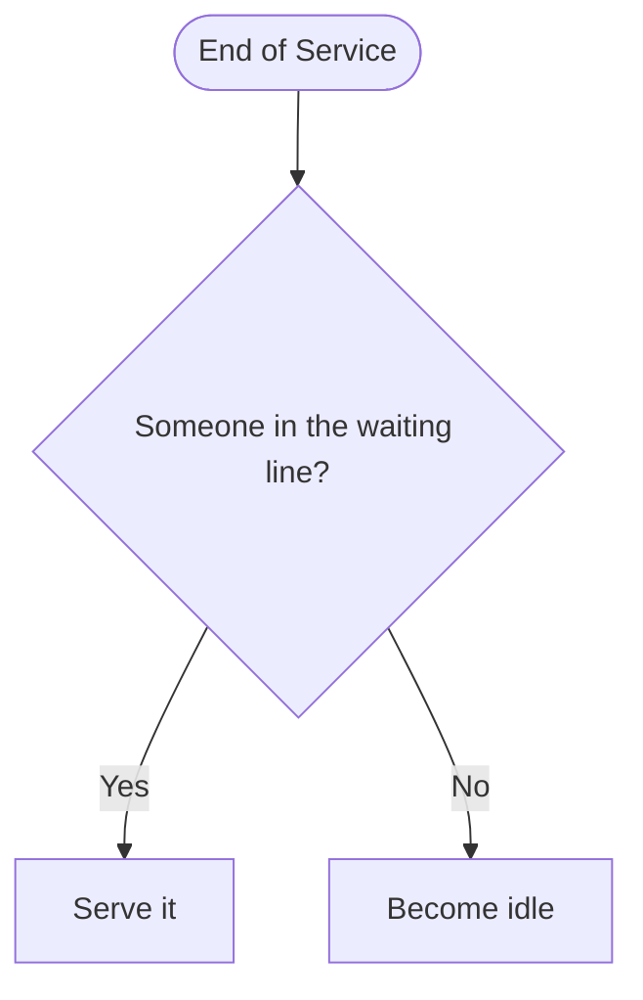
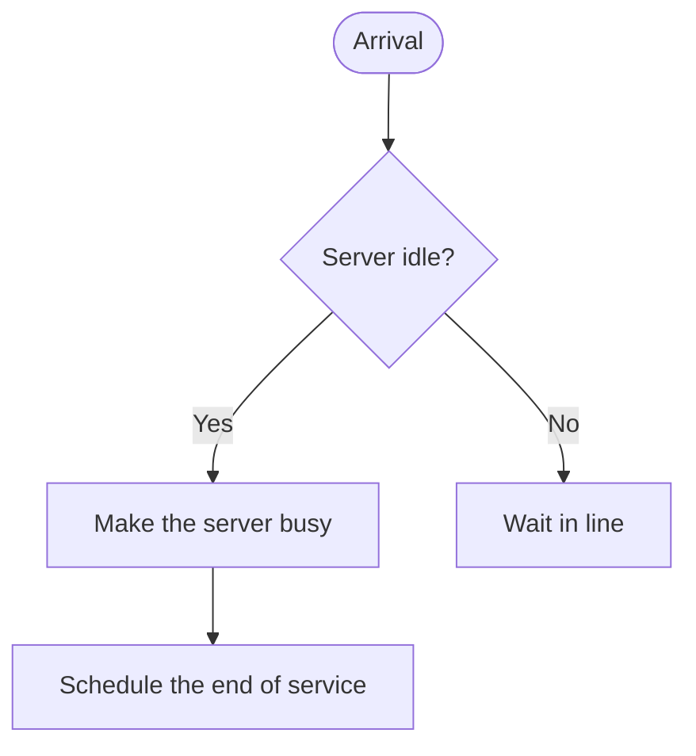
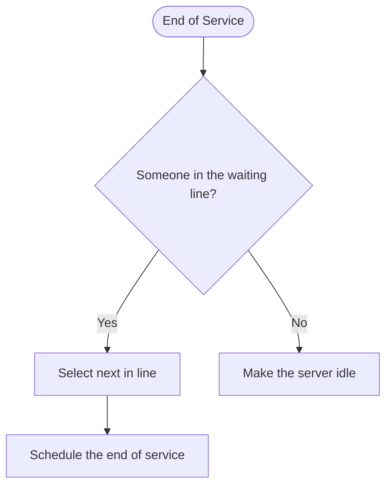
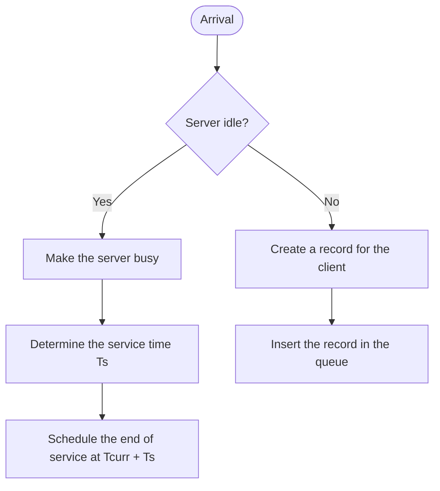
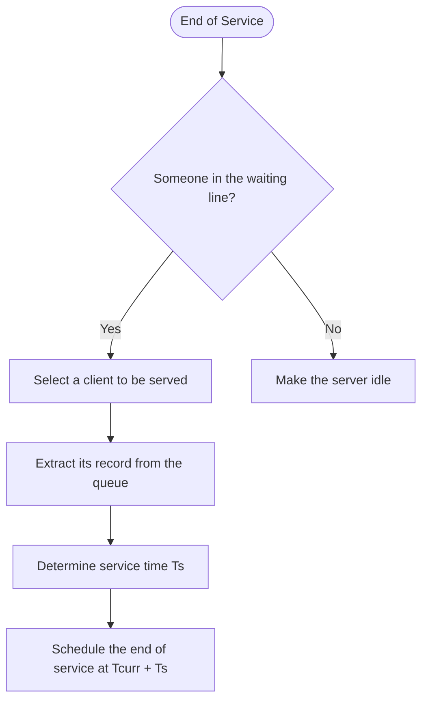
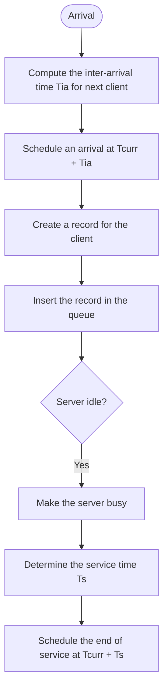
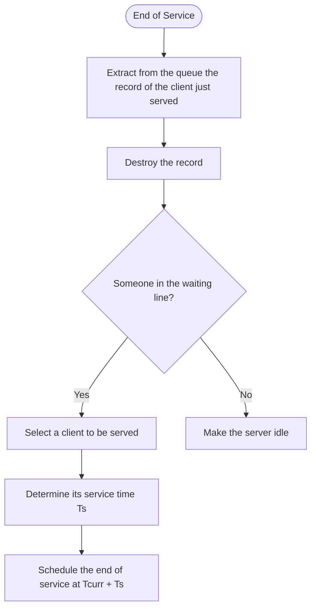

We want to model a system using a **discrete-event simulator**.
In this model, events are seen as an **instantaneous time occurrences** at which the system state changes.
The **time advances through discrete steps** from one event to the next.
The way the system evolves depends on the nature of the **intervals between events**, whose duration can be either deterministic or stochastic.

### Next Event Approach
Since we are interested in the system just in the moments at which its **state changes**, there is no
need to model the system between state changes.
So, we use a next event approach:
> the system time jumps forward with discrete steps to the time instant at which the next state change (i.e. an event) happens.

![[Discrete-Event Modeling-1793798594293.webp|506]]

We can use two different modeling approach:
- Event Scheduling
- Process Interaction

---
# Event Scheduling
> We can focus on the actions to be performed when each event happens.

This approach require that we decide when in the future an event must happen and we schedule its execution.

We need to define:
- the entities
- the result we want to obtain
- the state variables
- the events that makes the state variable changes

### Events
For each event, **we must define the sequence of operations** to be executed when the event
happens.
These operations depend on the state of
- the entity that have triggered the event
- other entity of the system
An important operation executed when an event is triggered is the **scheduling of new events**.
In this way, starting from few events scheduled at the beginning of the simulation, the system will naturally evolve through the cause/effect relations among events.

## Model of a queuing system

>  Approach Start with a **very simple version** of the model, then improve it with **incremental steps** after identifying any detail that is needed and missing.

Two events are modeled: 
- **Arrival**, a client arrives
- **End of Service**, a client has been served and goes away

### Version 1.0
#### Arrival

#### End of Service

Limits of Version 1.0
 - Version 1.0 is **very simplistic**
 - The **relations between events** are missing
     - _End of Service_ events are caused by the presence of clients in the system and by their services
 - ➜ We need to make these relations **explicit**
---
### Version 2.0
#### Arrival

#### End of Service

Key point: The **end of each service is planned at its start**.

Still missing
 - Each service has its **own duration**, which must be chosen according to the requirements of the considered system
 - We may need to **store information about the waiting clients** in suitable data structures

---
### Version 3.0

#### Arrival

#### End of Service

We are still missing **how to control the arrival of the clients.**
The arrival is usually a random process, the most common solution is by self-sustaining: **at each arrival, the next one is scheduled.**
We also need to develop a correct and coherent management of the records for the clients.

---
### Version 4.0

#### Arrival

### End of Service

# Process Interaction
This modeling approach is focused on the actions performed by each entity during its lifetime in the system.
A process is a sequence of events and activities involving a single entity.
The behavior of each entity depends on the actions and the state of the other entities in the system.
In this model we need to highlight the **interaction between entities** and, as a consequence, between the processes they are represented from.

## Events
The events are now representing **suspensions and reactivations** in the execution flow of the
entity.

We have two classes of events:
- **Uncoditional:**  the time at which the event happens is known in advance
- **Conditional:** the time at which the event actually happens depends on external conditions
