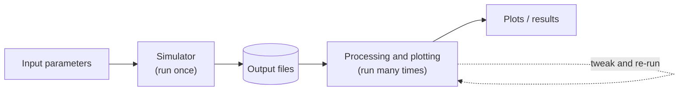
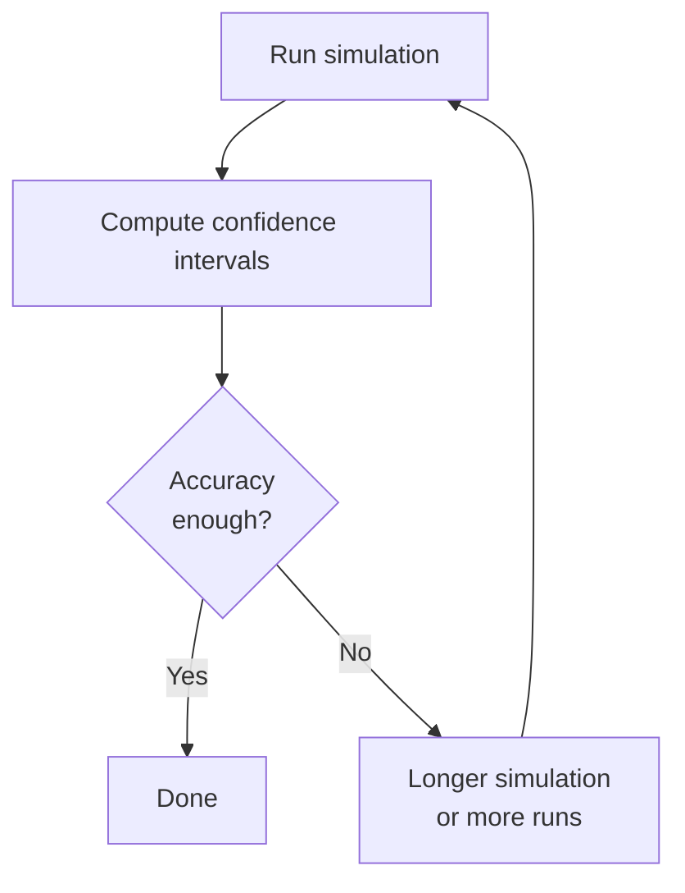

# Designing the simulator
---
Before coding, clarify for the simulator:
- **assumptions**
- **inputs** (e.g., parameters, files, etc.)
- **outputs** (e.g., performance metrics, files, etc.)
- **data structures**
- **algorithms**

> Concentrate on the **question you want to address** with your simulations.

# Simulation code
---
- **Comment your code** as much as you can
	- helpful not only for the others but also for the programmer
- **Print the simulator input parameters**
	- helpful to recover the settings adopted in the simulation when analyzing the data
- **Debug very carefully** under very simple toy cases
- For long simulations, it is useful to **plot some real-time information** to understand if the simulator keeps running as expected

# Simulation architecture
---
Distinguish between:
- code for the **simulation**
- code for the **output processing and graph plotting**

The simulation generates output files with the data to be processed. Typically, the simulator is run **just once**, and then the processing and plotting code is run **multiple times**.

# Input parameters
---
Choose the input parameters carefully to get **meaningful results**, i.e., in a reasonable range:
- avoid extreme/degenerate cases
- this requires an **a-priori intuition** of how the original system works

# Validation of the simulator
---

> Validation is the **most difficult and most important** step.

Run and study the results under:
- **toy cases or corner cases** in which the behavior can be easily predicted
- cases for which some **analytical formula is known**

# Simulation duration
---
How long should each simulation run? How many runs? The only correct answer: **it depends**.

Only by checking the **confidence intervals** is it possible to know whether the accuracy is enough, and thus whether the duration was enough.

> Short simulations are much, much better than long ones, **as long as the desired accuracy is achieved**.

## Two phases

| | Development, debugging and validation | "In production" simulation |
|---|---|---|
| **Duration** | very short (few seconds/minutes) | long enough (seconds/minutes/hours/days) |
| **Goal** | get immediate results | reach the desired accuracy |
| **Results used for** | preliminary results, very useful for debugging and validation | final results for the report, the thesis, the scientific paper, etc. |

# Common mistakes
---

| Mistake | Why it is a problem / what to do |
|---|---|
| **Too long simulations** | use confidence intervals to understand the accuracy |
| **Too complex simulation model** with respect to the required study | it is useless/counterproductive to keep any detail in the model that has no relevance in the final result |
| **Too complex scripting pipes** | if anything goes wrong, the output is unpredictable and it is hard to understand that a problem occurred |

# Plots
---
- Any plot must **always** report the labels on the x-axis and y-axis, with the corresponding **unit of measurement**
- With multiple curves, **each of them must be labeled**
- Curve style:
	- **line-points** → more appropriate for simulation/experimental data
	- **lines** → more appropriate for theoretical curves
